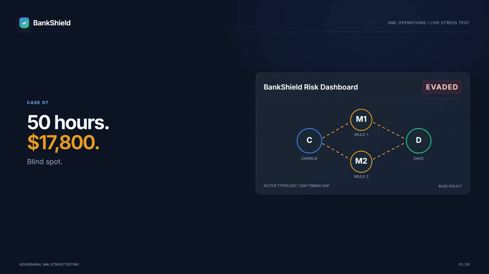

# BankShield

[](https://www.python.org/downloads/)
[](https://opensource.org/licenses/MIT)
[](#statutory-and-regulatory-mapping)
[](#model-risk-governance)

> **Adversarial stress-testing environment for Anti-Money Laundering (AML) transaction monitoring systems.**  
> BankShield deploys concurrent generative AI red-teams to discover surveillance blind spots before illicit actors exploit them, paired with deterministic double-entry accounting guardrails ($Assets = Liabilities + Equity$) and an automated compliance auditor.

## Demo Walkthrough (Credits: **[brag](https://github.com/latent-spaces/brag)**)

<div align="center">
  
  <p><em>BankShield in action: Multi-agent adversarial red-teaming, transaction evasion, and real-time policy remediation.</em></p>
</div>

## The Real-World Dilemma

Financial institutions spend over **$206 billion annually** on financial crime compliance (LexisNexis, 2023). Despite this investment:
* **Over 95% of generated alerts are false positives** (FATF, 2021; McKinsey, 2020), exhausting human investigators with noise.
* **Legacy rule engines remain vulnerable to deliberate pacing:** In October 2024, the U.S. Department of Justice and FinCEN penalized TD Bank **$3.09 billion** for systemic Bank Secrecy Act failures (U.S. DOJ, 2024). Syndicates moved hundreds of millions of dollars simply by pacing transfers slightly beyond 48-hour aggregation windows and fanning out across intermediary mule accounts.
* **Testing is historically reactive:** Banks typically discover monitoring blind spots only after a law enforcement subpoena or an audit penalty.

BankShield applies the principles of automated software red-teaming to financial compliance: continuously stress-testing monitoring rules with multi-agent adversaries while enforcing unbreakable accounting laws.

## System Architecture

BankShield strictly separates probabilistic exploration from mathematical verification under Federal Reserve SR 11-7 model risk governance:

```
┌────────────────────────────────────────────────────────────────────────┐
│             1. CONCURRENT ADVERSARIAL SWARM (swarm.py)                 │
│  [Chronos: 50h+ Pacing]  [Hydra: Mule Ring]  [Phantom: Micro-Smurf]    │
│            + [MarketNoise: Benign Payroll & POS Traffic]               │
└───────────────────────────────────┬────────────────────────────────────┘
                                    │ Concurrent Transaction Streams
                                    ▼
┌────────────────────────────────────────────────────────────────────────┐
│             2. THREAD-SAFE BANK LEDGER (engine.py)                     │
│  Double-Entry Balance Invariant: Assets = Liabilities + Equity          │
│  Mutex-Synchronized State Updates (Zero Synthetic Currency Drift)      │
└───────────────────────────────────┬────────────────────────────────────┘
                                    │ Verified Transfers
                                    ▼
┌────────────────────────────────────────────────────────────────────────┐
│             3. DETERMINISTIC BANK RULE ENGINE (engine.py)              │
│  - RULE_CTR_01: Single Transfer >= $10,000 (31 CFR 1010.311)           │
│  - RULE_STRUC_03: Rolling 48h Aggregation >= $10,000 (Anti-Smurfing)   │
│  - RULE_VEL_04: High Outbound Velocity (> 4 transfers in 2 hours)      │
│  - RULE_CYCLE_05: Directed Graph Loop Detection (A -> B -> C -> A)     │
└───────────────────┬────────────────────────────────┬───────────────────┘
                    │                                │
      [Flagged: Rule Intercepted]       [Unflagged: Evasion Confirmed]
                    │                                │
                    ▼                                ▼
     ┌─────────────────────────────┐  ┌──────────────────────────────────┐
     │ Parameter Mutation Feedback │  │    TWIN FINAL DELIVERABLES       │
     │ Loop back to Red-Team Agent │  │                                  │
     └─────────────────────────────┘  │ 1. auditor_report.md             │
                                      │    Formal Compliance Audit &     │
                                      │    Code Remediation Diffs        │
                                      │                                  │
                                      │ 2. visualizer.html               │
                                      │    Interactive Decision Visualizer│
                                      │    & Policy Remediation Sandbox  │
                                      └──────────────────────────────────┘
```

> **Why LLMs never execute math:** Large language models hallucinate arithmetic sums and drift nondeterministically. BankShield uses LLMs solely for generating creative transaction hypotheses. Ledger balance updates, threshold checks, and invariant proofs are executed exclusively by deterministic Python code.

## Interactive Decision Visualizer (`visualizer.html`)

BankShield generates a standalone, offline, single-file browser visualizer (`visualizer.html`) equipped with an interactive policy simulator:

```
+-----------------------------------------------------------------------------------------+
| [BANKSHIELD RISK DASHBOARD]  Status: [ EVADED (UNFLAGGED) ] -> [ INTERCEPTED (FLAGGED) ]|
+-----------------------------------------------------------------------------------------+
| TOPOLOGY GRAPH (SVG)               | INTERACTIVE REMEDIATION SIMULATOR                  |
|                                    |                                                    |
|  [CHARLIE] ($17.8k Origin)         | [X] Extend Aggregation Window (48h -> 72h)         |
|      /              \              | [X] Enable 2-Hop Beneficiary Graph Aggregation     |
|     v                v             |                                                    |
| [MULE 1] ($9k)   [MULE 2] ($9k)    | LIVE STATUS:                                       |
|     \                /             | > Flipping toggles ON instantly re-evaluates the   |
|      v              v              |   evasion, highlights the flagged edge in green,   |
|   [DAVE] ($17.8k Destination)      |   and displays the exact rule remediation code.    |
|                                    |                                                    |
| TIMELINE SCRUBBER: [T=0h ======●=== T=52h]   Ledger Invariant: Assets = Liab + Equity   |
+-----------------------------------------------------------------------------------------+
```

Open `visualizer.html` directly in any web browser without running local web servers or installing external packages.

## Quickstart Guide

### Prerequisites
* Python 3.8 or higher.
* Zero external pip dependencies required (built entirely on Python standard libraries).

### Installation
```bash
git clone https://github.com/Charukhesh/BankShield.git
cd BankShield
```

### Execution Pipeline

#### 1. Run the Deterministic Golden Benchmark
Tests 10 baseline scenarios including routine retail, CTR large wires, structuring, circular routing, and 3 adversarial evasions:
```bash
python test_scenarios.py
```

#### 2. Run the Single Adversarial Red-Team Loop
Prompts an exploratory agent to find an unflagged route. If flagged, the agent ingests the violation and mutates its parameters across iterative search attempts:
```bash
python adversary.py
```

#### 3. Run the Concurrent Multi-Agent Swarm Stress Test
Launches 4 specialized agents concurrently via `ThreadPoolExecutor` against the synchronized, thread-safe banking environment:
```bash
python swarm.py
```
* **Agent Chronos (Temporal Boundary Pacer):** Tests 50h+ lookback window resets.
* **Agent Hydra (Multi-Hop Mule Ring):** Distributes funds across intermediate nodes.
* **Agent Phantom (Micro-Jitter Smurfer):** Paces sub-$2,000 transactions.
* **Agent MarketNoise (Benign Volume):** Concurrently injects commercial payroll and retail traffic.

#### 4. Generate the Compliance Audit Report
Prompts the compliance auditor agent via the Gemini API to analyze the simulation logs and produce the formal regulatory report:
```bash
python auditor.py
```
* Generates **`auditor_report.md`** with statutory mappings to FinCEN and FATF, false-positive impact analyses, and concrete Python rule diffs.

#### 5. Generate and Launch the Interactive Visualizer
Prompts the API to build the self-contained dashboard:
```bash
python visualizer.py
```
* Generates **`visualizer.html`**. Open it in any browser (`start visualizer.html` on Windows or `open visualizer.html` on macOS/Linux).

## Optional API Configuration

BankShield automatically falls back to deterministic procedural generators if no API keys are provided. To activate live language models via Google Gemini or OpenRouter, add your key to a local `.env` file (which is git-ignored):

```env
GEMINI_API_KEY=your_gemini_api_key_here
# or
OPENROUTER_API_KEY=your_openrouter_api_key_here
```

## Repository Map

| File | Type | Description |
| :--- | :--- | :--- |
| **[`engine.py`](file:///c:/Users/charu/Downloads/Projects/BankShield/engine.py)** | Core Runtime | Double-entry balance ledger ($Assets = Liabilities + Equity$) and deterministic rule checks (CTR, structuring, velocity, cycle detection). |
| **[`test_scenarios.py`](file:///c:/Users/charu/Downloads/Projects/BankShield/test_scenarios.py)** | Benchmark Suite | 10 golden test scenarios for regression testing and baseline calibration. |
| **[`adversary.py`](file:///c:/Users/charu/Downloads/Projects/BankShield/adversary.py)** | Red Team | Generative red-team loop with closed-loop parameter mutation upon rule rejection. |
| **[`swarm.py`](file:///c:/Users/charu/Downloads/Projects/BankShield/swarm.py)** | Multi-Agent Swarm | Concurrent multi-agent execution (Chronos, Hydra, Phantom, MarketNoise) targeting a thread-safe synchronized ledger. |
| **[`auditor.py`](file:///c:/Users/charu/Downloads/Projects/BankShield/auditor.py)** | Blue Team | Compliance auditor querying Gemini API to synthesize regulatory audit findings and patch diffs. |
| **[`auditor_report.md`](file:///c:/Users/charu/Downloads/Projects/BankShield/auditor_report.md)** | **Final Deliverable A** | Comprehensive vulnerability audit cataloging the 5 systemic monitoring loopholes with statutory citations and SR 11-7 model risk governance. |
| **[`visualizer.py`](file:///c:/Users/charu/Downloads/Projects/BankShield/visualizer.py)** | Generator | Builds the standalone operations visualizer. |
| **[`visualizer.html`](file:///c:/Users/charu/Downloads/Projects/BankShield/visualizer.html)** | **Final Deliverable B** | Standalone browser visualizer with animated SVG topology graph, timeline controls, and counterfactual policy toggles. |

## The 5 Systemic Loopholes Cataloged

1. **Fixed 48-Hour Lookback Window Reset (`RULE_STRUC_03`):** Spacing two $8,000 transfers 50 hours apart resets the rolling accumulator, allowing $16,000 to move unflagged.
2. **Multi-Hop Mule Layering (1-Hop Blind Spot):** Originating transfers to multiple distinct mules who subsequent forward to a final recipient avoids single-counterparty accumulation.
3. **Velocity Burst Segmentation (`RULE_VEL_04`):** Spacing transfers at 2-hour-and-10-minute intervals resets the 2-hour burst counter.
4. **Sub-Threshold Micro-Structuring:** Transferring amounts under $2,000 (such as $1,950) bypasses structuring rules that only scan the $2,000 to $9,999 range.
5. **Graph Topology Disconnection:** Lack of 2-hop transitive graph traversal blinds engines to distributed funnel networks.

## Statutory and Regulatory References

1. **U.S. Department of Justice (2024):** TD Bank Pleads Guilty to Bank Secrecy Act and Money Laundering Conspiracies in $3 Billion Resolution, Press Release 24-1188.
2. **31 CFR \S 1010.311:** Reports by financial institutions of currency transactions (CTR mandatory filing threshold).
3. **31 CFR \S 1010.100(xx) & 31 U.S.C. \S 5324:** Anti-Structuring provisions under the Bank Secrecy Act.
4. **FinCEN Advisory FIN-2021-A003:** Guidance on funnel accounts and small-dollar multi-hop layering schemes.
5. **Financial Action Task Force (FATF):** Recommendations 1 (Risk-Based Approach), 16 (Wire Transfer Transparency), and 20 (Suspicious Transaction Reporting).
6. **Federal Reserve Board & OCC (2011):** Supervisory Guidance on Model Risk Management, Federal Reserve SR Letter 11-7 / OCC Bulletin 2011-12.
7. **IBM Research (2023):** Realistic Synthetic Financial Transactions for Anti-Money Laundering Models, NeurIPS Benchmark Suite.
8. **Dennis Heijmans et al. (2026):** Towards Adversarially Robust Multigraph Neural Networks for Financial Crime Analysis, arXiv:2610.16000.

## Acknowledgements

Special thanks to the open-source **[brag](https://github.com/latent-spaces/brag)** repository by Latent Spaces for the automated project launch video generation workflow.

## License

This project is licensed under the MIT License. See `LICENSE` for details.
